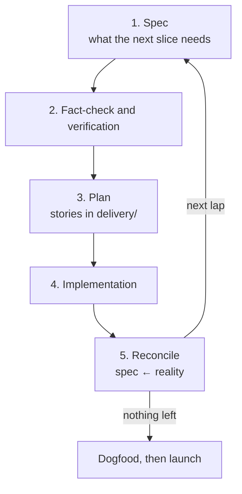

# Launch Plan

How we get from here to launch. The spec and the implementation are built together, in
repeating laps, not one after the other. Each lap's stories live in
[delivery/](../delivery/0100_agile-delivery-stories.md); this page holds the process and
the milestones, not the story list.

**Launch** means a public open-source beta: a pre-release version that someone outside
the project can find on the website, install from npm, and run a test case with.

**Deploy to production first** The npm package and the website go live
before there is any real functionality, and every change after that ships through the
real release path.

## The loop

1. **Spec.** Ideate and flesh out the [`spec/`](../spec/) spec documents. 

2. **Fact-check and Verification**

   - Check claims about external systems are checked are correct. 
      - Link to canonical documentation where it can be found.
      - Create bash script does a simple execution of a
     coding harness and captures its output to a `.txt` file. Both files are committed. This work is done in [scratchpad/](../scratchpad)
   - Outstanding questions the slice depends on are answered.
   - Spec parsing:
     - Does everything make sense?
     - Is terminology documented? Are aliases documented?
     - Is terminology used consistently?
3. **Agile delivery plan.** Turn the slice into high-level, human-readable stories in
   [delivery/](../delivery/0100_agile-delivery-stories.md). These become the task list - each one should be a single commit on main.
4. **Implementation.** Implement the stories. Each story leaves a
   working application, and each lap ships as a release.
5. **Reconcile.** The code is now the evidence. Update the spec to match what was built,
   record newly found non-goals, and repeat the spec parsing checks over the pages the lap
   touched.

## Lap 1 also delivers the foundations

The first lap builds the things every later lap relies on, alongside its own stories:

- Release pipeline for the npm package, and the website deployed on every release.
- Basic tooling: TypeScript, linting, file-structure linting. See
  [140-tooling.md](140-tooling.md).
- The test layers in [120-test-boundaries.md](120-test-boundaries.md).
- CI for Thunderjar itself.
- The ralph loop tooling.

## Dogfooding and launch

Run Thunderjar on real projects, and check it answers the questions in
[010-motivation.md](010-motivation.md). Then announce the public beta.

## Where we are

Lap 1, step 2 (Plan): refining the stories in [delivery/](../delivery/).
