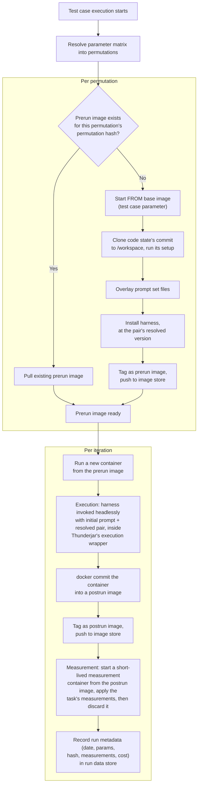

# Docker Execution

The Docker run mechanics and resulting artifacts. See
[081-docker-tagging.md](081-docker-tagging.md) for how the resulting prerun/postrun
images are named, and [030-terminology.md](030-terminology.md#container-run-lifecycle) for
the **prerun image** / **postrun image** / **container run** definitions this process
implements.

## Process



The per-permutation steps are the fold over each parameter's `applyParameter` fragment,
in the order shown. _(Referenced by:
[060-test-case-parameters.md](060-test-case-parameters.md#declarations-and-applyparameter).)_

The container started at `K` has no Docker daemon, so a task can't have the agent run
Docker itself. _(Referenced by: [020-goals-non-goals.md](020-goals-non-goals.md).)_

What gets written to the run data store at `P` is covered in
[085-test-case-results.md](085-test-case-results.md).

## Why commit happens before measurement

Measurement runs at `O`, *after* the postrun image has been committed and pushed — not
against the still-running execution container. _(Referenced by:
[030-terminology.md](030-terminology.md#container-run),
[085-test-case-results.md](085-test-case-results.md),
[087-collecting-token-costs.md](087-collecting-token-costs.md).)_

- **The postrun image stays exactly the agent's end state.** Measuring in a separate,
  discarded container keeps rendered test files, freshly installed dependencies, and test
  output out of the preserved artifact.
- **First-pass measurement and backfill become the same path.** Applying a new
  measurement to a year-old run is the same operation as measuring a fresh one: start a
  measurement container from the postrun image and run the instrument against it. See
  [085-test-case-results.md](085-test-case-results.md).
- **The artifact is durable before anything can go wrong.** If measurement crashes, the
  image is already pushed, so the run isn't lost — the measurements can simply be applied
  again later.

The harness writes its own result JSON (usage, cost, session ID) to a fixed path inside
the container at `L`, before the commit at `M`, so those numbers are preserved *in* the
postrun image rather than only captured on stdout. A measurement container can therefore
read them years later, exactly as the original run did.

## The execution wrapper

At `L`, Thunderjar doesn't run the harness's `cli` command directly. It wraps it, inside
the container, to enforce the [initial prompt's timeout](066-task.md#timeout) and to record when
the agent started, when it finished, and how it exited:

```sh
start=$(date +%s%3N)
timeout 600 <command returned by the harness's cli>   # 600: the initial prompt's timeoutSeconds
code=$?
end=$(date +%s%3N)
echo "{\"startedAt\":$start,\"finishedAt\":$end,\"exitCode\":$code}" > /thunderjar/run.json
```

```json
{ "startedAt": 1790692255104, "finishedAt": 1790692297416, "exitCode": 0 }
```

The file is written before `docker commit`, so like the harness's result file it is
preserved in the postrun image, and a run's timing and exit code can be re-read from the
image alone. Harness authors do nothing for this — the wrapper belongs to Thunderjar.
Timestamps come from the host kernel's clock, which containers share.

What this times is the agent's execution only: harness start to exit. Image pulls,
container setup and measurement are not part of it — measurement happens after commit,
and its duration changes every time measurements are backfilled, so it isn't a fact about
the run. _(Referenced by: [085-test-case-results.md](085-test-case-results.md#execution),
[064-harness.md](064-harness.md).)_

## When the agent fails

A container run fails when the harness exits non-zero, or runs past the initial prompt's timeout.
`timeout` kills the harness and exits `124`, so both cases reach the wrapper as an exit
code.

| Exit code | `outcome` |
|---|---|
| `0` | `completed` |
| `124` | `timedOut` |
| anything else | `failed` |

```json
{ "startedAt": 1790692255104, "finishedAt": 1790692855104, "exitCode": 124 }
```

- The postrun image is still committed and pushed, so a failed run can be restored and
  inspected.
- The run is recorded with its `outcome` — see
  [085-test-case-results.md](085-test-case-results.md#execution).
- **It is not measured.** No measurement container is started, and its Result is empty.
- The test case execution carries on with its remaining container runs.

There are no cost or resource limits. How a failed run counts in its permutation's
aggregation result is unresolved — see
[020-goals-non-goals.md](020-goals-non-goals.md#to-revisit).
_(Referenced by: [085-test-case-results.md](085-test-case-results.md#execution),
[066-task.md](066-task.md#timeout), [020-goals-non-goals.md](020-goals-non-goals.md).)_

